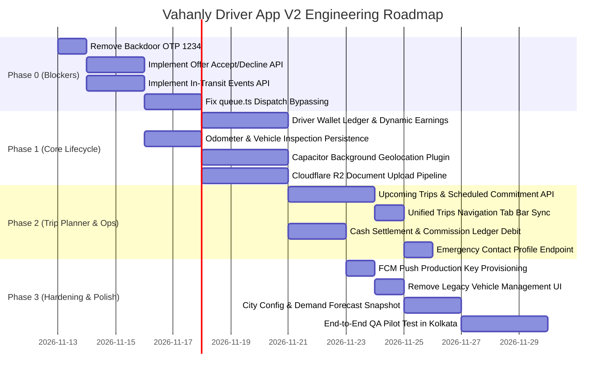

# Driver App Redesign & Production Architecture Plan (V2 Proposed)

- **Date:** 2026-11-12
- **Document Version:** 2.0 (Supersedes 2026-07-09 V1 Plan)
- **Target Applications:** `client-app/` (Driver Web & Mobile), `workers/api/` (Edge Backend), `workers/cron/` (Daemons), `database/migrations/` (Neon PostGIS)
- **Authors:** Principal Software Architect, Senior Mobile Product Architect, Full-Stack Lead, QA Lead
- **Status:** **PROPOSED — READY FOR ENGINEERING EXECUTION**

---

## 1. Executive Summary & Why V2 is Required

On 2026-07-09, the original `DOC/DRIVER_APP_REDESIGN_PLAN.md` established an initial design vision for the Vahanly driver application based on Aura tokens and a 4-tab bottom navigation bar. However, that plan assumed a legacy backend architecture (Go monolith on a GCP VM with Kafka, Redis, and local Docker OSRM) and made the critical error of assuming that "60+ driver routes" already existed and only needed 5 new endpoints.

Subsequent architectural evolution and our rigorous code audit revealed that:
1. **The Infrastructure Changed Completely:** On 2026-09-29, Vahanly migrated to a **Cloudflare-only serverless edge deployment** (`DOC/ADR-cloudflare-migration.md`) using Cloudflare Workers (`workers/api`), SQLite Durable Objects (`CityDispatchDO`, `OrderStreamDO`), Neon Postgres, and Cloudflare R2.
2. **The Backend Edge API was a Skeleton:** When `workers/api/src/routes/driver.ts` was implemented, only ~12 routes were ported. Crucial operational endpoints (dispatch offers, in-transit toll/parking events, upcoming scheduled trips, and KYC document uploads) were never built.
3. **Severe Operational and Security Blockers Exist:** A hardcoded backdoor OTP (`1234`) allows any driver to start any trip without rider verification; driver earnings return hardcoded static values (`₹38,000` withdrawable); and the web-based geolocation pauses when drivers lock their phones or switch to Google Maps.

**Plan V2 provides a realistic, end-to-end, production-ready blueprint** that aligns the driver app with the Cloudflare edge stack, fixes the disconnected dispatch loops, enforces financial correctness, and establishes native mobile stability.

---

## 2. Product Scope & Non-Goals

### Product Scope: The "Rider-Owns-Car" Driver Service
Vahanly operates in the **driver-on-hire (personal driver)** domain in India (starting with Kolkata, `KOL`). In this model:
- The **customer owns the car** (personal Sedan, Hatchback, SUV, or Luxury vehicle).
- The **driver is an expert chauffeur** hired for one-way trips, round trips, hourly rentals, or outstation commutes.
- The driver does **not** provide a commercial taxi.
- The driver is entrusted with a valuable asset, requiring strict vehicle handoff protocols (odometer readings, fuel percentage, damage checks).

### Explicit Non-Goals
1. **Taxi / Fleet Vehicle Registration:** Drivers do not register personal cars to drive. The existing "Add Vehicle (Make, Model, License Plate)" screen in `driver-account/vehicles` is a taxi-hailing holdover and is removed from the driver product scope.
2. **Cleartext Transport:** We explicitly reject DriveU's practice of transmitting credentials (`driver_id`, `imei`) over cleartext HTTP GET query strings. All Vahanly communication is strictly encrypted over HTTPS using JWT bearer tokens.
3. **Complex Gamification for Launch:** Complex features like scratch-and-win cards, multi-level achievement trees, or aggregator integrations (e.g. Rapido) are deferred to post-launch phases.

---

## 3. Revised Information Architecture (IA)

```
[Tab Bar (4 Tabs) — Fixed Bottom]
├── Home (/driver)
│   ├── Offline: Duty Toggle + Battery/Health Status + Bento Grid (Today's Summary) + Demand Forecast Tile
│   ├── Online: Live Map + City Dispatch Status + Collapsed Peek Bento + Layer Toggle Chips (Demand / Heat)
│   └── Active Trip Overlays (State-Driven Modal Sheets):
│       ├── Offer Takeover (15s circular countdown, fare, pickup distance, transmission type)
│       ├── En Route Navigation (Turn-by-turn ETA, chat with rider, rider live pin, cancel)
│       ├── Arrived at Pickup (Wait timer, vehicle inspection: start odometer, fuel %, Start OTP entry)
│       ├── In-Transit (Live speedometer, toll/parking expense drawer, wait timer, route polylines)
│       └── Trip Completion (End odometer, final fare summary, cash collection confirm / digital status)
│
├── Trips (/driver/trips) [Renamed & Unified from /jobs]
│   ├── Segment 1: Upcoming (Trip Planner)
│   │   ├── Committed Bookings (Date-grouped list with countdown timers and alarm triggers)
│   │   └── Available Scheduled Offers (Advance trips open for early commitment)
│   └── Segment 2: History
│       └── Completed & Cancelled past trips with date filters, payout breakdowns, and receipts
│
├── Earn (/driver/earnings)
│   ├── Live Earnings Ticker (Today's net earnings & completed trips count)
│   ├── Withdrawable Balance Card (Dynamic real balance calculated from wallet ledger)
│   ├── Weekly Earnings Bar Chart (7-day trend from completed orders)
│   ├── Request Instant Payout CTA (Triggers PayoutBatchWorkflow)
│   └── Active Incentives & Daily Quests Strip
│
└── Me (/driver-account)
    ├── Profile Header (Name, Phone, Rating, Total Trips, Verification Badge)
    ├── Driving Expertise (Transmission proficiencies: Manual, Automatic, Luxury EV)
    ├── Safety & Emergency (Emergency contact CRUD, SOS settings, live support)
    ├── Documents & KYC (License, Aadhaar, PAN with VALID / EXPIRING / EXPIRED chips)
    ├── Bank Account & Payout Methods (UPI ID / IFSC verification)
    ├── App Settings (Language selector, dark map toggle, battery optimization settings)
    └── Help & Support (Support tickets, phone dialer to Kolkata operations)
```

---

## 4. Screen-by-Screen Redesign Specifications

| Screen / Component | Route | Target Platform | User Action & Behavior | Dependencies |
|:---|:---|:---|:---|:---|
| **Shell & Navigation** | Global | Web & Mobile | Fixed 4-tab bottom navigation (`TabBarRedesign.tsx`). Height 56px + `env(safe-area-inset-bottom)`. Hides automatically during active trip overlays (`ARRIVED`, `IN_TRANSIT`). | Aura tokens |
| **Home (Offline)** | `/driver` | Web & Mobile | Large "Go Online" toggle switch. Pre-flight health check validates battery >= 20% and location permissions. Bento grid displays today's completed trips and earnings. Demand forecast card highlights busy hours (e.g. "High demand in Salt Lake 6-9 PM"). | `useDriverDutyStore`, `CityDispatchDO` |
| **Home (Online)** | `/driver` | Web & Mobile | Full-screen interactive map with current driver pin. Status chip reads "Online · Searching for jobs". Heatmap layer toggle chips (Surge vs Demand Clusters). Background telemetry streams GPS fixes every 5 seconds. | `DriverMap.tsx`, `HeatmapDO`, Geolocation Plugin |
| **Dispatch Offer Takeover** | Overlay | Web & Mobile | Full-screen modal takeover with high-priority audio alert. Displays total fare (₹), estimated distance to pickup, trip type ("In-City One Way", "Outstation"), and transmission requirement ("Manual Sedan"). 15-second animated SVG countdown ring. "Accept Trip" (slider or prominent button) and "Decline" button. | `OfferScreen.tsx`, `useOfferStore`, `workers/api` |
| **En Route to Pickup** | Overlay | Web & Mobile | Top card displays rider name, pickup address, and estimated arrival time. "Navigate in Google Maps" button opens native navigation. Floating in-app chat button and one-tap phone call button. Bottom sheet with "I Have Arrived" CTA. | `ArrivedVerificationPane.tsx`, `Google Maps` |
| **Arrived & Vehicle Inspection** | Overlay | Web & Mobile | 5-minute free waiting timer countdown with accrued overtime billing. Vehicle inspection form: Starting Odometer (numeric input), Fuel Gauge (% slider), Odometer Photo (camera capture). 4-digit numeric OTP input field with strict verification. | `workers/api` (`verify-otp`) |
| **In-Transit HUD** | Overlay | Web & Mobile | Destination address and live route polyline. Speedometer reading. "Add Expense" drawer to input toll plaza receipts (₹) and parking fees. "Start Wait" button for round-trip intermediate stops. Red "SOS" button (2-second hold to activate). "End Trip" CTA. | `TripInProgressPane.tsx`, `workers/api` (`events`) |
| **Trip Completion & Settlement** | Overlay | Web & Mobile | Prompt for Ending Odometer (km). Displays itemized final bill: Base Fare + Distance/Time Overages + Tolls + Parking + Wait Charges. If Cash payment: "Collect ₹[Amount] Cash from Customer" confirmation. "Complete & Return to Duty" CTA. | `workers/api` (`end`, `ledger`) |
| **Trips (Upcoming & History)** | `/driver/trips` | Web & Mobile | Segmented pill control: "Upcoming" vs "History". Upcoming tab lists committed advance bookings with "Start Trip" activation at T-40 min, plus available scheduled offers to commit. History tab lists past trips with fare receipts. | `workers/api` (`trips/upcoming`, `history`) |
| **Earnings & Wallet Ledger** | `/driver/earnings` | Web & Mobile | Live balance card: "Withdrawable Balance" backed by dynamic database ledger. "Request Payout" opens instant withdrawal modal. 7-day earnings bar chart. Itemized recent trip payout list showing gross fare, platform commission (20%), and net earnings. | `workers/api` (`driver/earnings`, `payouts`) |
| **KYC Document Hub** | `/driver-account/documents` | Web & Mobile | List of required documents: Driving License, Aadhaar Card, PAN Card, Police Clearance. Status chips: `VERIFIED` (green), `UNDER_REVIEW` (yellow), `EXPIRING_SOON` (orange), `REJECTED` (red). Re-upload button opens camera/gallery and uploads to Cloudflare R2. | Cloudflare R2, `DocExpiryWorkflow` |

---

## 5. Backend Edge Architecture & API Contracts (`workers/api`)

### 5.1 Missing Endpoints to Implement in `workers/api/src/routes/driver.ts`

#### 1. Dispatch Offer Lifecycle
- `GET /api/v1/driver/offer`
  - **Auth:** Driver JWT
  - **Returns:** Current active offer for this driver (order ID, pickup lat/lng, fare, vehicle tier, expires_in_seconds) or `{ offer: null }`.
- `PATCH /api/v1/driver/orders/:id/offer-response`
  - **Auth:** Driver JWT
  - **Body:** `{ response: 'ACCEPTED' | 'DECLINED', reason?: string }`
  - **Behavior:** If `ACCEPTED`, atomically checks if offer is still valid, updates order to `ASSIGNED`, sets driver to `BUSY`, and broadcasts `order.assigned` to `OrderStreamDO`. If `DECLINED`, unlocks driver and triggers dispatch re-match.

#### 2. In-Transit Order Events & Billing Adjustments
- `POST /api/v1/driver/orders/:id/events`
  - **Auth:** Driver JWT
  - **Body:** `{ type: 'TOLL' | 'PARKING' | 'WAIT_START' | 'WAIT_END', amount_paise?: number, notes?: string }`
  - **Behavior:** Inserts into `order_events` table; atomically increments `orders.extra_charges_paise`; broadcasts `order.expense_added` to rider stream.

#### 3. Trip Start OTP & Vehicle Inspection Handoff
- `PATCH /api/v1/driver/orders/:id/verify-otp`
  - **Auth:** Driver JWT
  - **Body:** `{ otp: string, start_odometer_km: number, start_fuel_pct: number, odometer_photo_url?: string }`
  - **Security Fix:** **Remove backdoor `1234` code!** Enforce exact match with `orders.start_otp`.
  - **Behavior:** Saves inspection metrics into `orders`, updates status to `IN_TRANSIT`, sets `started_at = now()`, broadcasts `trip.started`.

#### 4. Trip Completion, Odometer Checkout & Payment
- `PATCH /api/v1/driver/orders/:id/end`
  - **Auth:** Driver JWT
  - **Body:** `{ end_odometer_km: number, end_fuel_pct?: number, cash_collected_paise?: number }`
  - **Behavior:** Calculates final total fare, records ending odometer, writes double-entry financial record in `driver_wallet_ledger`, transitions driver status back to `ONLINE_AVAILABLE`, broadcasts `trip.completed`.

#### 5. Scheduled Bookings (Trip Planner)
- `GET /api/v1/driver/trips/upcoming`
  - **Auth:** Driver JWT
  - **Returns:** List of advance bookings assigned or committed to this driver where `orders.scheduled_at > now()`.
- `GET /api/v1/driver/scheduled-offers`
  - **Auth:** Driver JWT
  - **Returns:** Open advance bookings in the driver's operating city available for early commitment.
- `POST /api/v1/driver/scheduled-offers/:id/accept`
  - **Auth:** Driver JWT
  - **Behavior:** Commits driver to scheduled trip, sets order status to `RESERVED`, logs commitment in `scheduled_commitments`.

#### 6. Document KYC & Cloudflare R2 Uploads
- `POST /api/v1/driver/onboarding/presigned-url`
  - **Auth:** Driver JWT
  - **Body:** `{ document_type: 'DRIVING_LICENSE' | 'AADHAAR' | 'PAN' | 'PROFILE_PHOTO', content_type: string }`
  - **Behavior:** Generates a scoped Cloudflare R2 upload path (`documents/{driver_id}/{doc_type}_{timestamp}.jpg`).
- `POST /api/v1/driver/onboarding/step/verify`
  - **Auth:** Driver JWT
  - **Body:** `{ step_id: number, document_url: string, document_number?: string, expiry_date?: string }`
  - **Behavior:** Records document in `driver_documents` with status `SUBMITTED`.

#### 7. Safety & Profile Management
- `PATCH /api/v1/driver/profile/emergency-contact`
  - **Auth:** Driver JWT
  - **Body:** `{ name: string, phone: string, relationship: string }`
  - **Behavior:** Updates `drivers.emergency_contact` JSONB.

---

## 6. Data Model & Database Schema Additions (Neon PostGIS)

```sql
-- Migration: Add vehicle inspection fields to orders
ALTER TABLE orders 
  ADD COLUMN IF NOT EXISTS start_odometer_km NUMERIC(8, 2),
  ADD COLUMN IF NOT EXISTS end_odometer_km NUMERIC(8, 2),
  ADD COLUMN IF NOT EXISTS start_fuel_pct INTEGER,
  ADD COLUMN IF NOT EXISTS end_fuel_pct INTEGER,
  ADD COLUMN IF NOT EXISTS odometer_photo_url TEXT,
  ADD COLUMN IF NOT EXISTS extra_charges_paise BIGINT DEFAULT 0,
  ADD COLUMN IF NOT EXISTS toll_charges_paise BIGINT DEFAULT 0,
  ADD COLUMN IF NOT EXISTS parking_charges_paise BIGINT DEFAULT 0,
  ADD COLUMN IF NOT EXISTS wait_duration_seconds INTEGER DEFAULT 0;

-- Migration: Create Driver Wallet Ledger for Financial Correctness
CREATE TABLE IF NOT EXISTS driver_wallet_ledger (
  id UUID PRIMARY KEY DEFAULT gen_random_uuid(),
  driver_id UUID NOT NULL REFERENCES drivers(id) ON DELETE CASCADE,
  order_id UUID REFERENCES orders(id) ON DELETE SET NULL,
  entry_type VARCHAR(32) NOT NULL, -- 'TRIP_EARNING', 'PLATFORM_FEE', 'CASH_COLLECTED', 'TOLL_REIMBURSEMENT', 'PAYOUT_WITHDRAWAL', 'INCENTIVE_BONUS'
  amount_paise BIGINT NOT NULL,     -- Positive for credit, negative for debit
  balance_after_paise BIGINT NOT NULL,
  description TEXT,
  created_at TIMESTAMPTZ NOT NULL DEFAULT now()
);
CREATE INDEX IF NOT EXISTS idx_driver_ledger_driver ON driver_wallet_ledger(driver_id, created_at DESC);

-- Migration: Create Order In-Transit Events Table
CREATE TABLE IF NOT EXISTS order_events (
  id UUID PRIMARY KEY DEFAULT gen_random_uuid(),
  order_id UUID NOT NULL REFERENCES orders(id) ON DELETE CASCADE,
  event_type VARCHAR(32) NOT NULL, -- 'TOLL', 'PARKING', 'WAIT_START', 'WAIT_RESUME', 'ROUTE_DEVIATION'
  amount_paise BIGINT DEFAULT 0,
  payload JSONB DEFAULT '{}'::jsonb,
  recorded_by UUID NOT NULL,
  created_at TIMESTAMPTZ NOT NULL DEFAULT now()
);
CREATE INDEX IF NOT EXISTS idx_order_events_order ON order_events(order_id);

-- Migration: Create Active Dispatch Offers Table for 15s Window
CREATE TABLE IF NOT EXISTS dispatch_offers (
  id UUID PRIMARY KEY DEFAULT gen_random_uuid(),
  order_id UUID NOT NULL REFERENCES orders(id) ON DELETE CASCADE,
  driver_id UUID NOT NULL REFERENCES drivers(id) ON DELETE CASCADE,
  status VARCHAR(24) NOT NULL DEFAULT 'PENDING', -- 'PENDING', 'ACCEPTED', 'DECLINED', 'EXPIRED'
  expires_at TIMESTAMPTZ NOT NULL,
  created_at TIMESTAMPTZ NOT NULL DEFAULT now(),
  responded_at TIMESTAMPTZ
);
CREATE INDEX IF NOT EXISTS idx_dispatch_offers_driver ON dispatch_offers(driver_id, status, expires_at);
```

---

## 7. Native Mobile Runtime & Capacitor Lifecycle Strategy

### The Web vs. Native Mobile Reality
In a driver application, **continuous background geolocation is safety-critical and operational**. Unlike rider applications, drivers spend 90% of their active trip time looking at external navigation (Google Maps) or with their phone in a dashboard mount while locked.
- **Web Limitation:** Browser JavaScript (`navigator.geolocation`) is throttled or suspended by Android within 30 seconds of backgrounding.
- **Capacitor Native Solution:**
  1. Add `@capacitor-community/background-geolocation` to `client-app`.
  2. Implement an Android **Foreground Service** with a non-dismissable notification:
     - Notification Title: `Vahanly Driver — On Active Trip`
     - Notification Text: `Tracking GPS route to destination`
     - Channel Importance: `HIGH`
  3. This informs the Android OS that the app is an active foreground location service, preventing OS-level task killing and keeping GPS polling alive at 5-second intervals.
  4. Pre-flight battery health check warns drivers if battery is < 20% before allowing them to go online.

---

## 8. Phased Implementation Roadmap



### Phase 0: Critical P0 Release Blockers (Week 1)
- **Task 0.1:** Remove universal backdoor OTP `1234` from `workers/api/src/routes/driver.ts#L151`.
- **Task 0.2:** Implement `GET /api/v1/driver/offer` and `PATCH /api/v1/driver/orders/:id/offer-response` in `workers/api`.
- **Task 0.3:** Implement `POST /api/v1/driver/orders/:id/events` for in-transit tolls and parking.
- **Task 0.4:** Fix `workers/api/src/queue.ts` so `order.created` creates a 15-second dispatch offer rather than force-assigning orders.

### Phase 1: Core Lifecycle & Financial Correctness (Week 2)
- **Task 1.1:** Build `driver_wallet_ledger` schema and replace mock earnings endpoints with live SQL queries.
- **Task 1.2:** Persist starting/ending odometer readings and fuel metrics in `orders` upon `verify-otp` and `end`.
- **Task 1.3:** Configure `@capacitor-community/background-geolocation` with Android foreground service.
- **Task 1.4:** Wire Cloudflare R2 presigned URL uploads for KYC documents in `driver-onboarding`.

### Phase 2: Trip Planner & Operational Hardening (Week 3)
- **Task 2.1:** Implement `GET /api/v1/driver/trips/upcoming` and `POST /api/v1/driver/scheduled-offers/:id/accept`.
- **Task 2.2:** Update `TabBarRedesign.tsx` Tab 2 to route to unified `/driver/trips` (Upcoming + History).
- **Task 2.3:** Implement post-trip cash collection flow with automated platform commission debit.
- **Task 2.4:** Implement `PATCH /api/v1/driver/profile/emergency-contact`.

### Phase 3: Polish, Clean-up & Production Verification (Week 4)
- **Task 3.1:** Provision valid production FCM VAPID keys and verify push receipt.
- **Task 3.2:** Remove legacy "Vehicles" management from driver Account tab; replace with transmission skill profile.
- **Task 3.3:** Populate Cloudflare KV demand forecast snapshots for Kolkata pilot zones.
- **Task 3.4:** Execute end-to-end multi-role QA test suite (Rider -> Dispatch -> Driver -> Admin).

---

## 9. Production Exit Criteria Checklist

Before Vahanly Driver Application can be certified for pilot launch in Kolkata:
- [ ] **Zero Backdoor OTPs:** `1234` returns HTTP 400; only rider-generated 4-digit PIN starts the trip.
- [ ] **15s Offer Flow Functional:** Driver sees `OfferScreen`, accepts within 15 seconds, and order transitions to `ASSIGNED`.
- [ ] **Background Geolocation Tested:** Driver locks phone or uses Google Maps navigation for 15 minutes; GPS updates continue to stream without interruption.
- [ ] **Financial Ledger Audit Passed:** Driver with 0 trips has ₹0 balance; completing a trip credits net payout; cash trip debits platform fee.
- [ ] **Odometer Recorded:** Starting and ending odometer readings are mandatory and stored in PostgreSQL.
- [ ] **Tolls & Parking Billable:** Driver adds ₹100 toll mid-trip; toll appears on customer invoice at trip completion.
- [ ] **Scheduled Bookings Visible:** Advance bookings appear in "Upcoming" tab; lead-time alarm activates trip at T-40 min.
- [ ] **R2 KYC Uploads Verified:** Driver uploads driving license photo; photo persists in Cloudflare R2 bucket and is reviewable in Admin Control Room.
- [ ] **Emergency SOS Live:** Holding SOS button broadcasts incident to `global-sos` Durable Object and alerts operations.
