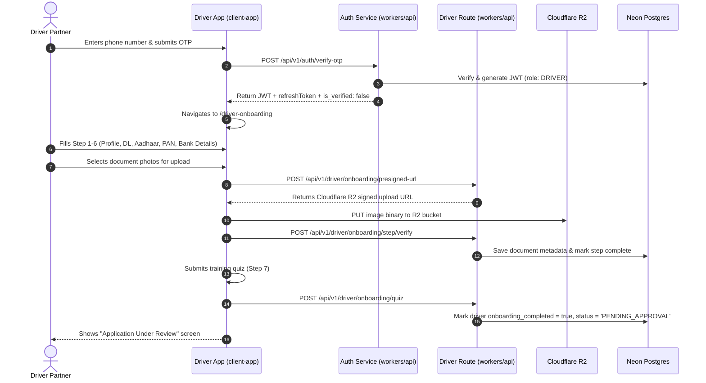
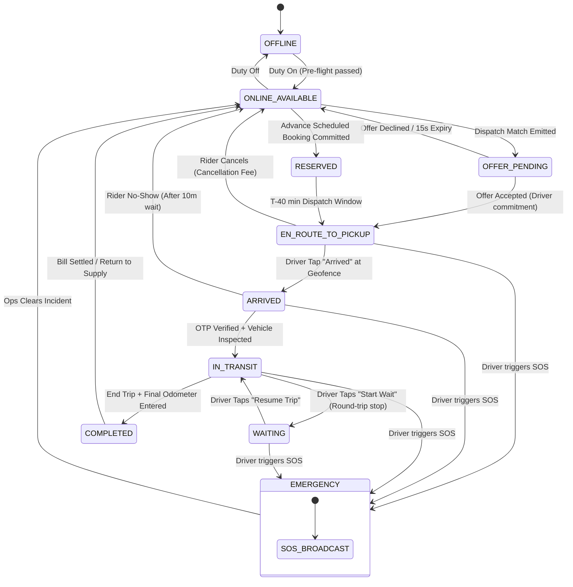

# Driver Journey and State Machine Audit: Vahanly Platform

- **Audit Date:** 2026-11-12
- **Scope:** Complete Driver Lifecycle, State Transitions, Cross-Role Synchronization, and Edge Failure Modes
- **Auditors:** Senior Mobile Architect, Principal Distributed Systems Engineer, QA Lead

---

## 1. End-to-End Driver User Journeys

### Journey 1: Driver Registration, KYC Submission & Onboarding


#### Layer-by-Layer Verification & Defects:
- **UI (`client-app/src/app/driver-onboarding/page.tsx`):** Well-structured 7-step wizard utilizing Aura tokens and step indicators.
- **Client Networking (`client-app/src/api/client.ts#L911-L1095`):** Implements `getOnboardingStep`, `saveOnboardingStep`, `getPresignedUrl`, `uploadDocumentDirect`, and `submitQuiz`.
- **Backend (`workers/api/src/routes/`):** **CRITICAL GAP.** The edge backend omits all `/api/v1/driver/onboarding/*` routes! Submitting any step fails with a 404 error. Drivers cannot complete onboarding against the active Cloudflare Worker.

---

### Journey 2: Going On-Duty & Pre-Flight Health Gating
```mermaid
sequenceDiagram
    autonumber
    actor Driver as Driver Partner
    participant Client as Driver App (client-app)
    participant Cap as Capacitor Native / Device
    participant Edge as Driver API (workers/api)
    participant DO as CityDispatchDO (Durable Object)
    participant DB as Neon Postgres

    Driver->>Client: Toggles "Go Online" switch
    Client->>Cap: Check battery level & location permissions
    Cap-->>Client: Battery: 65%, Location: AUTHORIZED_ALWAYS
    Client->>Cap: Start background geolocation service
    Client->>Edge: POST /api/v1/driver/duty { state: 'ONLINE_AVAILABLE', lat, lng }
    Edge->>DB: UPDATE drivers SET current_state = 'ONLINE_AVAILABLE'
    Edge->>DO: CityDispatchDO.setDriverStatus(driverId, 'ONLINE_AVAILABLE')
    Edge->>DO: CityDispatchDO.locationUpdate(driverId, lat, lng)
    Edge-->>Client: { success: true, current_state: 'ONLINE_AVAILABLE' }
    Client->>Client: Transition dutyState to ONLINE; mount HomeOnline view
    loop Continuous Telemetry (Every 5s)
        Client->>Edge: POST /api/v1/driver/location { lat, lng, bearing, speed }
        Edge->>DO: CityDispatchDO.locationUpdate(driverId, lat, lng)
    end
```

#### Layer-by-Layer Verification & Defects:
- **UI (`client-app/src/components/home/HomeOffline.tsx` & `HomeOnline.tsx`):** Functional duty switch; bento grid transforms into online map with live tracking chips.
- **State Store (`client-app/src/store/useDriverDutyStore.ts`):** Updates state to `ONLINE` upon successful API call.
- **Backend (`workers/api/src/routes/driver.ts#L10-L42`):** Successfully updates `drivers.current_state` and invokes `CityDispatchDO.setDriverStatus`.
- **Gaps:** Zero battery or network health gating exists. Pure web JS stops geolocation when the screen turns off or the driver switches apps.

---

### Journey 3: Live Dispatch Offer Receipt & Acceptance (15s Window)
```mermaid
sequenceDiagram
    autonumber
    participant Queue as Cloudflare Queue (order.created)
    participant DO as CityDispatchDO (KOL)
    participant Stream as OrderStreamDO (global-driver)
    participant Client as Driver App (client-app)
    actor Driver as Driver Partner
    participant Edge as Driver API (workers/api)
    participant DB as Neon Postgres

    Queue->>DO: matchOrder({ orderId, pickupLat, pickupLng, pickupH3 })
    DO->>DO: Find closest available driver (e.g. driver-123)
    DO->>DO: Lock driver in SQLite index (status = 'OFFER_PENDING')
    DO->>Stream: Broadcast 'driver.offer' to driver-123
    Stream-->>Client: WebSocket frame: { type: 'driver.offer', order: {...}, expires_at }
    Client->>Client: Play ring tone; mount OfferScreen with 15s SVG countdown
    alt Driver Accepts (Within 15s)
        Driver->>Client: Taps "Accept Offer"
        Client->>Edge: PATCH /api/v1/driver/orders/:id/offer-response { response: 'ACCEPTED' }
        Edge->>DB: UPDATE orders SET status = 'ASSIGNED', driver_id = :driverId
        Edge->>DO: CityDispatchDO.setDriverStatus(driverId, 'ASSIGNED')
        Edge-->>Client: { success: true, status: 'ASSIGNED' }
        Client->>Client: Transition to EN_ROUTE; mount navigation pane
    else Driver Declines or 15s Timeout
        Driver->>Client: Taps "Decline" OR 15s expires
        Client->>Edge: PATCH /api/v1/driver/orders/:id/offer-response { response: 'DECLINED' }
        Edge->>DO: CityDispatchDO.unlockDriver(driverId)
        DO->>Queue: Re-queue order for next candidate
        Client->>Client: Dismiss OfferScreen; return to ONLINE map
    end
```

#### Layer-by-Layer Verification & Defects:
- **UI (`client-app/src/components/OfferScreen.tsx`):** Beautifully designed countdown ring, fare, distance, and trip type display.
- **State Store (`client-app/src/store/useOfferStore.ts`):** Wall-clock countdown calculation resilient to component remounts.
- **Backend Disconnection (`workers/api/src/queue.ts#L33-L41`):** **CRITICAL P0 DEFECT.** In `queue.ts`, the worker bypasses the entire offer phase! It directly updates the database to `ASSIGNED` without ever creating an offer or notifying the driver. Furthermore, `PATCH /api/v1/driver/orders/:id/offer-response` 404s on `workers/api`. The live offer acceptance journey is completely broken.

---

### Journey 4: Arrival, Waiting & OTP Verification with Vehicle Inspection
```mermaid
sequenceDiagram
    autonumber
    actor Driver as Driver Partner
    participant Client as Driver App (client-app)
    participant Edge as Driver API (workers/api)
    participant Stream as OrderStreamDO (:orderId)
    participant DB as Neon Postgres
    actor Rider as Customer (Car Owner)

    Driver->>Client: Taps "I Have Arrived" at pickup location
    Client->>Edge: PATCH /api/v1/driver/orders/:id/arrived
    Edge->>DB: UPDATE orders SET status = 'ARRIVED', arrived_at = now()
    Edge->>Stream: broadcastJSON({ type: 'driver.arrived' })
    Stream-->>Rider: Push notification: "Your driver has arrived"
    Client->>Client: Start 5-minute free wait timer
    Driver->>Rider: Meets customer & inspects personal vehicle
    Driver->>Client: Inputs starting odometer (km), fuel %, captures odometer photo
    Driver->>Rider: Requests 4-digit Start Trip OTP
    Rider-->>Driver: Provides OTP (e.g. 5842)
    Driver->>Client: Enters OTP into ArrivedVerificationPane
    Client->>Edge: PATCH /api/v1/driver/orders/:id/verify-otp { otp: '5842', start_odometer: 42150, start_fuel: 85 }
    Edge->>DB: Verify OTP against orders.start_otp & store inspection metrics
    Edge->>DB: UPDATE orders SET status = 'IN_TRANSIT', started_at = now()
    Edge->>Stream: broadcastJSON({ type: 'trip.started' })
    Edge-->>Client: { success: true, status: 'IN_TRANSIT' }
    Client->>Client: Transition dutyState to DELIVERING; mount TripInProgressPane
```

#### Layer-by-Layer Verification & Defects:
- **UI (`client-app/src/app/driver/trip/live/ArrivedVerificationPane.tsx`):** Functional OTP inputs, odometer field, and arrival timer.
- **Backend (`workers/api/src/routes/driver.ts#L141-L169`):** 
  - `PATCH /orders/:id/arrived` works and broadcasts to `OrderStreamDO`.
  - **SECURITY BACKDOOR:** `PATCH /orders/:id/verify-otp` line 151 has:
    ```ts
    if (rows[0].start_otp !== body.otp && body.otp !== '1234') {
      return c.json({ success: false, error: 'invalid OTP' }, 400);
    }
    ```
    Bypasses rider verification with universal backdoor code `1234`.
  - **Data Loss:** Starting odometer and fuel readings submitted by the frontend are ignored and dropped by the backend handler.

---

### Journey 5: In-Transit Tolls, Parking & Trip Completion
```mermaid
sequenceDiagram
    autonumber
    actor Driver as Driver Partner
    participant Client as Driver App (client-app)
    participant Edge as Driver API (workers/api)
    participant Stream as OrderStreamDO (:orderId)
    participant DB as Neon Postgres
    actor Rider as Customer

    loop Mid-Trip Expenses
        Driver->>Client: Adds toll charge (₹120) or parking fee (₹50)
        Client->>Edge: POST /api/v1/driver/orders/:id/events { type: 'TOLL', amount_paise: 12000 }
        Edge->>DB: UPDATE orders SET extra_charges_paise = extra_charges_paise + 12000
        Edge->>Stream: broadcastJSON({ type: 'order.expense_added', amount_paise: 12000 })
    end
    Driver->>Client: Arrives at destination; inputs ending odometer (km)
    Driver->>Client: Taps "End Trip"
    Client->>Edge: PATCH /api/v1/driver/orders/:id/end { end_odometer: 42185 }
    Edge->>DB: UPDATE orders SET status = 'COMPLETED', completed_at = now()
    Edge->>DB: Calculate final fare (Base + Distance/Time overages + Tolls + Wait)
    Edge->>DB: Insert driver earnings transaction in driver_wallet_ledger
    Edge->>Stream: broadcastJSON({ type: 'trip.completed', total_fare_paise })
    Edge-->>Client: { success: true, status: 'COMPLETED', total_fare_paise }
    Client->>Client: Mounts payment collection dialog (Cash vs Online)
```

#### Layer-by-Layer Verification & Defects:
- **In-Transit Events:** `client-app/src/api/client.ts:1234` calls `/api/v1/driver/orders/:id/events`. **404 on `workers/api`!** Tolls and parking fees cannot be added to the booking.
- **Trip End:** `workers/api/src/routes/driver.ts#L171-L205` updates order status to `COMPLETED`, but:
  - Fails to record ending odometer readings.
  - Fails to recalculate dynamic overage charges or waiting time fees.
  - Fails to insert financial transactions into any ledger table.

---

## 2. Canonical Driver State Machine Specification



### State Machine Transition Contract

| Current State | Target State | Triggering Event / Action | Actor | Preconditions | Persisted Database Effect | Durable Object / Cache Effect | Emitted Events |
|:---|:---|:---|:---|:---|:---|:---|:---|
| `OFFLINE` | `ONLINE_AVAILABLE` | `DUTY_TOGGLE_ON` | Driver | KYC approved; battery >= 20%; GPS valid | `UPDATE drivers SET current_state = 'ONLINE_AVAILABLE'` | `CityDispatchDO.setDriverStatus(id, 'ONLINE_AVAILABLE')` | `driver.duty.online` |
| `ONLINE_AVAILABLE` | `OFFLINE` | `DUTY_TOGGLE_OFF` | Driver | No active order assigned | `UPDATE drivers SET current_state = 'OFFLINE'` | `CityDispatchDO.setDriverStatus(id, 'OFFLINE')` | `driver.duty.offline` |
| `ONLINE_AVAILABLE` | `OFFER_PENDING` | `DISPATCH_MATCH` | System | Nearest eligible driver identified | `INSERT INTO dispatch_offers (order_id, driver_id, expires_at)` | `CityDispatchDO.lockDriver(id)` | `driver.offer.created` |
| `OFFER_PENDING` | `ONLINE_AVAILABLE` | `OFFER_DECLINED` / `TIMEOUT` | Driver / System | Within 15s window or timer expired | `UPDATE dispatch_offers SET status = 'EXPIRED'` | `CityDispatchDO.unlockDriver(id)` | `driver.offer.expired` |
| `OFFER_PENDING` | `EN_ROUTE_TO_PICKUP` | `OFFER_ACCEPTED` | Driver | Within 15s window | `UPDATE orders SET status = 'ASSIGNED', driver_id = :id` | `CityDispatchDO.setDriverStatus(id, 'BUSY')` | `order.assigned` |
| `ONLINE_AVAILABLE` | `RESERVED` | `SCHEDULED_COMMIT` | Driver | Driver accepts advance booking | `UPDATE orders SET driver_id = :id, status = 'RESERVED'` | Local reservation logged | `order.scheduled.committed` |
| `RESERVED` | `EN_ROUTE_TO_PICKUP` | `LEAD_TIME_TRIGGER` | System | Current time >= `scheduled_at - 40min` | `UPDATE orders SET status = 'EN_ROUTE_TO_PICKUP'` | Order stream activated | `order.lead_time_activated` |
| `EN_ROUTE_TO_PICKUP` | `ARRIVED` | `ARRIVE_AT_PICKUP` | Driver | Driver within 200m geofence | `UPDATE orders SET status = 'ARRIVED', arrived_at = now()` | Broadcast arrival to `OrderStreamDO` | `driver.arrived` |
| `EN_ROUTE_TO_PICKUP` | `ONLINE_AVAILABLE` | `RIDER_CANCELLED` | Rider | Rider cancels before arrival | `UPDATE orders SET status = 'CANCELLED'` | `CityDispatchDO.setDriverStatus(id, 'ONLINE_AVAILABLE')` | `order.cancelled` |
| `ARRIVED` | `IN_TRANSIT` | `VERIFY_OTP_START` | Driver | Valid OTP + starting odometer entered | `UPDATE orders SET status = 'IN_TRANSIT', started_at = now()` | Broadcast start to `OrderStreamDO` | `trip.started` |
| `IN_TRANSIT` | `WAITING` | `WAIT_TIMER_START` | Driver | Vehicle halted at intermediate stop | `INSERT INTO order_waits (order_id, started_at)` | Stream update | `trip.waiting_started` |
| `WAITING` | `IN_TRANSIT` | `WAIT_TIMER_RESUME` | Driver | Trip resumed | `UPDATE order_waits SET ended_at = now()` | Stream update | `trip.waiting_ended` |
| `IN_TRANSIT` | `COMPLETED` | `END_TRIP_SUBMIT` | Driver | Final odometer entered | `UPDATE orders SET status = 'COMPLETED', completed_at = now()` | Post fare calculation | `trip.completed` |
| `COMPLETED` | `ONLINE_AVAILABLE` | `BILL_SETTLED` | Driver / Rider | Payment confirmed (Cash/UPI) | `INSERT INTO driver_wallet_ledger (...)` | `CityDispatchDO.setDriverStatus(id, 'ONLINE_AVAILABLE')` | `payment.settled` |
| Any Active | `EMERGENCY` | `SOS_TRIGGERED` | Driver | Driver presses & holds SOS | `INSERT INTO safety_incidents (...)` | Broadcast to `global-sos` DO | `sos.alert` |

---

## 3. Cross-Role State Synchronization Matrix

| Driver App State (`client-app`) | Order Status in Postgres (`orders.status`) | Rider App View (`rider-app`) | Admin Operations View (`frontend`) | CityDispatchDO State |
|:---|:---|:---|:---|:---|
| `OFFLINE` | N/A (Driver is offline) | Hidden from map | Grey pin on live fleet map | Not present in active index |
| `ONLINE_AVAILABLE` | N/A (Driver is idle) | Displayed as nearby available driver | Green pin on live fleet map | `ONLINE_AVAILABLE` (indexed in H3) |
| `OFFER_PENDING` | `OFFERED` | Searching animation ("Finding best driver...") | Yellow pulsating pin; order shows "Dispatched" | `LOCKED_OFFER` |
| `RESERVED` | `RESERVED` | "Driver Confirmed for [Time]" card | Scheduled trip marked "Assigned" | `RESERVED` (held until T-40m) |
| `EN_ROUTE_TO_PICKUP` | `ASSIGNED` / `EN_ROUTE_TO_PICKUP` | "Driver is on the way" + live car pin | Blue pin; active dispatch card | `BUSY` |
| `ARRIVED` | `ARRIVED` | "Driver has arrived at pickup" + Start OTP card | Flashing blue pin; wait counter active | `BUSY` |
| `IN_TRANSIT` | `IN_TRANSIT` | Live on-trip map + speed/ETA + Share Trip button | Solid blue route line; speed telemetry | `BUSY` |
| `WAITING` | `IN_TRANSIT` (with wait flag) | "Driver waiting at stop" + accrued wait fee | Yellow route marker; wait duration counter | `BUSY` |
| `COMPLETED` | `COMPLETED` | Final Bill Breakdown + Payment Selector | Trip marked completed; bill audited | Returns to `ONLINE_AVAILABLE` |
| `EMERGENCY` | Unchanged (flagged with incident) | Emergency alert modal on screen | **RED FLASHING INCIDENT** banner with audio alert | `EMERGENCY` |

---

## 4. Failure Scenarios, Resiliency & Recovery Protocol

### Scenario A: Network Drop or Socket Disconnect During 15s Offer Window
- **Failure Mode:** Driver receives offer over WebSocket, but cellular connection drops before driver can tap "Accept".
- **Current Behavior:** `useOfferStore` runs local countdown; tapping "Accept" fails network call; state reverts to `OFFER_PENDING` and hangs.
- **Recovery Protocol:**
  1. `useOfferStore.reconcilePendingOffer()` is already wired to trigger upon socket reconnection (`client-app/src/app/driver/page.tsx#L131-L135`).
  2. The endpoint `GET /api/v1/driver/offer` must return the authoritative remaining seconds (`offer_expires_in_seconds`).
  3. If remaining seconds <= 0, the store automatically clears the offer and returns the driver to `ONLINE_AVAILABLE`.

### Scenario B: Mobile Device Powered Off / Battery Dies Mid-Trip
- **Failure Mode:** Driver's phone runs out of battery during `IN_TRANSIT` with a customer in the personal car.
- **Current Behavior:** Telemetry stops. The trip remains in `IN_TRANSIT` indefinitely.
- **Recovery Protocol:**
  1. `workers/cron` scheduled task monitors `orders WHERE status = 'IN_TRANSIT' AND last_telemetry_at < now() - INTERVAL '15 minutes'`.
  2. Raises an automated `STALE_TELEMETRY` incident in `safety_incidents` for the admin control room.
  3. Operations support calls the rider and driver phones.
  4. When the driver recharges their phone and logs in, `AuthGuard` and `DriverTerminalPage` fetch active order (`GET /api/v1/driver/orders/active`) and instantly re-mount `TripInProgressPane` at the current destination.

### Scenario C: Rider Cancels While Driver is En Route to Pickup
- **Failure Mode:** Driver is navigating towards pickup; customer cancels booking.
- **Current Behavior:** If WebSocket is connected, `OrderStreamDO` broadcasts `order.cancelled`. If socket is disconnected, driver continues driving to pickup unaware of cancellation!
- **Recovery Protocol:**
  1. `workers/api/src/services/fcm.ts` sends a high-priority push notification (`priority: 'high'`) with sound to the driver's device upon order cancellation.
  2. When the driver's app receives the socket or push frame, it sounds an audio cancellation chime, mounts a modal explaining the cancellation, and credits the driver's wallet with the cancellation compensation fee.
  3. Automatically restores driver duty to `ONLINE_AVAILABLE`.

### Scenario D: Offline GPS Telemetry Buffering
- **Failure Mode:** Driver passes through an underground tunnel or low-reception area during transit.
- **Current Behavior:** `telemetryStream.ts` catches fetch error and drops the GPS fixes.
- **Recovery Protocol:**
  1. `client-app/src/services/telemetryStream.ts#L115-L121` already implements an in-memory queue (`flush()`).
  2. Persist unsent telemetry points to IndexedDB (`idb-keyval`) with timestamp and GPS accuracy.
  3. Upon network reconnection, batch upload up to 50 buffered fixes via `POST /api/v1/driver/sync/offline-payload` to reconstruct the true road path and odometer distances.
