# Vahanly Current System Map & Architecture Review

- **Date:** 2026-11-12
- **Audit Target:** Vahanly System Components & Implementation Stack
- **Auditor:** Principal Software Engineer & Infrastructure Architect

---

## 1. High-Level Architecture Overview

Vahanly is currently in a transitional state between two backend paradigms:
1. **Legacy Architecture (Go Microservices):** A multi-service Go 1.25 backend (`cmd/*`, `internal/*`) designed for Docker Compose / Kubernetes deployment, utilizing Kafka (KRaft), Redis 7.2 Cluster, Triton Inference Server, PostGIS, MinIO, and gRPC ingestion.
2. **Current Target Architecture (Cloudflare Serverless Edge):** Formally adopted on 2026-09-29 via [ADR-cloudflare-migration.md](file:///C:/workspace/Driver/DOC/ADR-cloudflare-migration.md) to achieve a zero-cost ($0/month) operational footprint. It consolidates the backend into TypeScript running on **Cloudflare Workers** (`workers/api` and `workers/cron`), SQLite-backed **Durable Objects**, **Cloudflare Queues**, **Cloudflare R2**, **Cloudflare KV**, and **Neon Serverless PostgreSQL** (via Cloudflare Hyperdrive).

The frontend consists of three distinct web applications, two of which are wrapped with **Capacitor 8** for native Android/iOS mobile deployment.

---

## 2. Component Inventory

```
C:\workspace\Driver\
├── rider-app/                 # Customer Mobile Application (Next.js 16 + Capacitor 8)
├── client-app/                # Driver-Partner Mobile Application (Next.js 16 + Capacitor 8)
├── frontend/                  # Operations & Admin Control Room (Vite 5 + React 19)
├── workers/
│   ├── api/                   # Active Cloudflare Worker API Gateway (Hono + Durable Objects)
│   └── cron/                  # Scheduled Worker (Minute sweeps, daily checks, hourly snapshots)
├── database/migrations/       # 125 PostgreSQL / PostGIS Schema Migrations
├── cmd/                       # Legacy Go Microservice Entrypoints (12 services)
├── internal/                  # Legacy Go Domain Logic, Routing Graph, Hungarian Matcher
├── deploy/                    # Kubernetes manifests, Helm charts, Prometheus/KEDA configs
└── model_repository/          # Triton XGBoost models (ETA and cancellation prediction)
```

### Detailed Component Specifications

| Component | Tech Stack | Runtime / Hosting | Primary Responsibilities |
|:---|:---|:---|:---|
| **Rider App** (`rider-app`) | Next.js 16.2.6, React 19.2.4, Capacitor 8.3.4, Tailwind CSS, Zustand 5, MapLibre GL 5.24 | Cloudflare Workers Static Assets / Android Capacitor APK | Customer booking UI: location search, vehicle selection, pricing quotes, dispatch radar, live trip tracking, payment settlement, saved places, garage. |
| **Driver App** (`client-app`) | Next.js 16.2.6, React 19.2.4, Capacitor 8.3.4, Tailwind CSS, Zustand 5, MapLibre GL 5.24 | Cloudflare Workers Static Assets / Android Capacitor APK | Driver partner terminal: duty toggle, GPS telemetry streaming, incoming job offers, trip navigation, OTP verification, odometer entry, earnings. |
| **Admin Control Room** (`frontend`) | Vite 5, React 19, React Router 6, Tailwind CSS, Lucide | Cloudflare Workers Static Assets (`admin.aniket.site`) | Fleet control room: live trip radar, real-time spatial heatmap, driver KYC approval queue, manual dispatch overrides, pricing freeze, ledger audit. |
| **Edge API Gateway** (`workers/api`) | TypeScript, Hono 4, Cloudflare Workers API | Cloudflare Workers Edge Network (`api.aniket.site`) | Unified REST & WebSocket gateway: JWT authentication, rate limiting, order lifecycle, payment webhooks, file proxying to R2, Durable Object routing. |
| **Scheduled Worker** (`workers/cron`) | TypeScript, Cloudflare Scheduled Handler | Cloudflare Cron Triggers (`* * * * *`, daily, hourly) | Background sweeps: order expiry, scheduled booking dispatch, stale driver cleanup, hourly KPI snapshots, document expiry warnings. |
| **Primary Relational Store** | PostgreSQL 16 + PostGIS 3.4 | Neon Serverless Postgres (pooled via Cloudflare Hyperdrive) | System of record for orders, users, drivers, vehicles, financial ledger, geofences, and document metadata. |
| **Edge State & Coordination** | Cloudflare Durable Objects (SQLite backend) | Cloudflare Edge Runtime | In-memory spatial index (`CityDispatchDO`), WebSockets (`OrderStreamDO`, `RiderStreamDO`), rate limits (`RateLimitDO`), sessions (`SessionDO`). |
| **Domain Event Bus** | Cloudflare Queues (`EVENTS`) | Cloudflare Edge Message Queue | Asynchronous event processing for `order.created`, `order.assigned`, `order.cancelled`, `driver.payout.requested`. |
| **Document Storage** | Cloudflare R2 (`vahnly-documents`) | Cloudflare Object Storage (S3-compatible) | Driver KYC documents (Aadhaar, DL), vehicle photos, odometer checkpoint images, support ticket attachments. |
| **Legacy Go Stack** (`cmd/*`, `internal/*`) | Go 1.25, Kafka, Redis 7.2 Cluster, Triton | Local Docker Compose / Offline CLI tools | High-performance batch simulation (`cmd/simulator`), OSM road graph preprocessor (`cmd/osm-preprocessor`), and migration runner (`cmd/migrate`). |

---

## 3. System Architecture & Data Flow Diagram

```mermaid
flowchart TD
    subgraph Clients["Frontend Clients (Mobile & Web)"]
        Rider["Rider App (Capacitor/Next.js)\n• BookingSheet\n• Dispatch Radar\n• LiveTripView"]
        Driver["Driver App (Capacitor/Next.js)\n• Duty Toggle\n• Telemetry Stream\n• Trip Execution"]
        Admin["Admin Portal (Vite/React)\n• Control Room\n• KYC Queue\n• Radar & Heatmap"]
    end

    subgraph Edge["Cloudflare Workers Platform (api.aniket.site)"]
        Hono["Edge API Gateway (Hono)\nworkers/api"]
        RateLimit["RateLimitDO\n(Sliding window)"]
        Session["SessionDO\n(Tokens & Idempotency)"]
        
        subgraph DO["Durable Objects (SQLite In-Memory State)"]
            CityDO["CityDispatchDO (KOL)\n• H3 Spatial Driver Index\n• Greedy / Proximity Matching\n• 5s Surge Recalculation"]
            OrderStream["OrderStreamDO\n• Driver WebSockets\n• GPS Points Buffer\n• Telemetry Fan-out"]
            RiderStream["RiderStreamDO\n• Rider WebSockets\n• Trip Event Push"]
            HeatmapDO["HeatmapDO\n• SSE Heatmap Stream"]
            LockDO["LockDO\n• Distributed Fencing Lock"]
        end

        Queue["Cloudflare Queues\n(EVENTS Topic)"]
        Cron["workers/cron Worker\n• Order Expiry\n• Scheduled Dispatch\n• Stale Driver Sweep"]
    end

    subgraph Storage["Datastores & External Services"]
        Hyperdrive["Cloudflare Hyperdrive\n(Connection Pooling)"]
        Neon["Neon Serverless PostgreSQL\n(PostGIS 16 Relational DB)"]
        R2["Cloudflare R2 Bucket\n(vahnly-documents)"]
        KV["Cloudflare KV\n(VAHNLY_CONFIG)"]
        Firebase["Firebase Auth & FCM\n(Phone OTP & Push)"]
    end

    %% Client Connections
    Rider -->|HTTPS REST| Hono
    Rider -->|WebSocket /ws/rider| RiderStream
    Driver -->|HTTPS REST| Hono
    Driver -->|REST GPS /driver/location| Hono
    Driver -->|WebSocket /api/v1/dispatch/stream| OrderStream
    Admin -->|HTTPS REST & Cookies| Hono
    Admin -->|SSE /api/v1/analytics/heatmap| HeatmapDO

    %% Internal Worker Routing
    Hono --> RateLimit
    Hono --> Session
    Hono --> CityDO
    Hono --> OrderStream
    Hono --> RiderStream
    Hono --> Queue
    Hono --> Hyperdrive
    Hono --> R2
    Hono --> KV

    %% Background / Async Processing
    Queue -->|Batch Consumer| Hono
    Cron -->|Minute Lock| LockDO
    Cron -->|Sweep Stale| CityDO
    Cron -->|Dispatch Scheduled| Queue
    Cron -->|Expire Orders| Hyperdrive

    %% Database & External
    Hyperdrive --> Neon
    Hono -.-> Firebase
```



---

## 4. Key Architectural Contracts & Divergences

### 4.1 Driver Geolocation Ingestion: gRPC vs REST
- **Documented Architecture (Go):** Drivers stream binary protobuf GPS points over HTTP/2 gRPC to `cmd/ingestion` (:50051), indexing locations into Redis H3 geospatial zsets.
- **Active Edge Implementation (Workers):** Cloudflare Workers do not terminate raw gRPC. Ingestion was replaced with HTTP REST (`POST /api/v1/driver/location`) pushing directly to `CityDispatchDO.locationUpdate()`, which updates an in-memory SQLite table `driver_index(h3, ts)`.

### 4.2 State Machine & Event Dispatch: Kafka vs Cloudflare Queues
- **Documented Architecture (Go):** Core transactions publish to Apache Kafka topics (`order.created`, `order.assigned`, `driver.location.updated`), consumed by decoupled Go daemons.
- **Active Edge Implementation (Workers):** High-frequency telemetry completely bypasses queuing. Domain events flow through Cloudflare Queues (`EVENTS`). However, `handleQueueBatch` in `workers/api/src/queue.ts` only handles 3 topics: `order.created`, `order.assigned`, and `order.cancelled`. All other domain events (driver ratings, payouts, support tickets) are unhandled.

### 4.3 Database Connection Management & Hyperdrive
- Cloudflare Workers run in an ephemeral V8 sandbox without long-lived TCP connection pools. Direct PostgreSQL connections from hundreds of worker isolates will rapidly exhaust Neon's connection limits.
- The platform uses **Cloudflare Hyperdrive** (`env.HYPERDRIVE`), providing edge connection pooling and 60-second read query caching. However, `workers/api/src/services/db.ts` falls back to direct `postgres(env.DATABASE_URL)` if Hyperdrive bindings are missing in development.

---

## 5. Technology Stack Summary

| Layer | Selected Technology | Version | Location |
|:---|:---|:---|:---|
| **Rider Frontend** | Next.js, React, Tailwind, Capacitor | Next 16.2.6, React 19.2.4, Cap 8.3.4 | `rider-app/` |
| **Driver Frontend** | Next.js, React, Tailwind, Capacitor | Next 16.2.6, React 19.2.4, Cap 8.3.4 | `client-app/` |
| **Admin Frontend** | Vite, React, Tailwind, Lucide | Vite 5, React 19 | `frontend/` |
| **API Runtime** | Cloudflare Workers, Hono | Hono 4, Node compat v2 | `workers/api/` |
| **Edge Storage** | Durable Objects (SQLite), Cloudflare KV, R2 | Cloudflare DO Hibernation API | `workers/api/src/durable-objects/` |
| **Database** | Neon Serverless PostgreSQL, PostGIS | Postgres 16, PostGIS 3.4 | `database/migrations/` |
| **External Auth** | Firebase Authentication | Firebase 12.14.0 | Client apps & Worker verify |
| **Push Notification** | Firebase Cloud Messaging (FCM) | FCM HTTP v1 | `workers/api/src/services/notifications.ts` |
| **Maps & Routing** | MapLibre GL, OpenStreetMap, Valhalla/OSRM | MapLibre 5.24 | `rider-app/src/components/map/` |
| **Package Managers** | npm (monorepo apps) + Go Modules (legacy tools) | npm 10+, Go 1.25 | Root & subdirectories |
