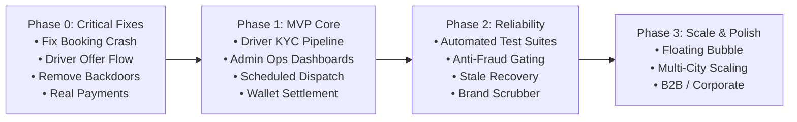

# Implementation Roadmap: Path to a Production Launch

- **Date:** 2026-11-12
- **Audit Target:** Vahanly Engineering Execution Plan
- **Auditor:** Principal Software Engineer & Senior Mobile Product Architect

---

## 1. Phased Delivery Overview

To transition Vahanly from its current fractured state to a stable, revenue-generating commercial launch in Kolkata (`KOL`), the engineering work is sequenced into 4 strict, dependency-aware phases.

---

## 2. Phase 0: Critical Correctness, Security & Core Unblocking

**Objective:** Unblock the primary customer conversion funnel and driver trip execution while eliminating critical security vulnerabilities and simulated payment stubs.

| Item ID | Work Item | Workstream | Findings Addressed | Dependencies | Effort |
|:---|:---|:---:|:---:|:---|:---:|
| **W0.1** | Unify `POST /api/v1/orders` response contract with `BookingSheet.tsx` | Backend / Rider | FIND-001 | None | XS |
| **W0.2** | Implement Driver Offer Flow in `workers/api` (`GET /offer`, `PATCH /offer-response`) | Backend / Driver | FIND-002 | `CityDispatchDO` | M |
| **W0.3** | Remove universal backdoor OTP `1234` and enforce 3-attempt lockout | Backend | FIND-005 | None | XS |
| **W0.4** | Require authentication on `POST /api/v1/orders` (remove fallback UUID) | Backend | FIND-010 | None | XS |
| **W0.5** | Enforce customer ownership check on `DELETE /api/v1/rider/orders/:id/cancel` | Backend | FIND-008 | None | XS |
| **W0.6** | Harmonize dispatch order status enums (`ASSIGNED` & `EN_ROUTE_TO_PICKUP`) | Backend / Rider | FIND-007 | None | S |
| **W0.7** | Implement `POST /api/v1/driver/orders/:id/events` for tolls & parking fees | Backend / Driver | FIND-004 | DB `ledger_entries` | S |
| **W0.8** | Replace client-side mock payments with Juspay / Razorpay Standard Checkout | Frontend / Backend | FIND-003 | Payment Merchant | L |
| **W0.9** | Eliminate `localStorage X-Admin-Role` header; enforce `HttpOnly` admin cookies | Admin / Backend | FIND-009 | Auth Service | S |

### Phase 0 Exit Criteria
1. Rider can book a trip without encountering a JavaScript `TypeError`.
2. Matched driver receives a 15-second incoming offer ring and must actively accept it.
3. Trip cannot be started without the real rider-provided OTP (no `1234` bypass).
4. Trip payment generates a genuine payment intent and verifies through a server-side webhook.
5. All P0 findings verified resolved.

---

## 3. Phase 1: Complete Intended Customer/Driver/Admin MVP Journeys

**Objective:** Establish complete operational readiness, allowing drivers to onboard, administrators to review KYC documents, scheduled trips to execute, and financial balances to reconcile.

| Item ID | Work Item | Workstream | Findings Addressed | Dependencies | Effort |
|:---|:---|:---:|:---:|:---|:---:|
| **W1.1** | Implement Driver KYC Document Upload to R2 and Admin Review Queue | Backend / Admin | FIND-011 | R2 Binding | L |
| **W1.2** | Implement Scheduled Booking Storage & Cron Dispatch Trigger | Backend / Jobs | FIND-014 | `workers/cron` | M |
| **W1.3** | Implement Driver Reassignment & Stale Offer Timeout in `workers/cron` | Jobs / Dispatch | FIND-013 | `CityDispatchDO` | M |
| **W1.4** | Port missing Admin Operations endpoints (Riders, Drivers, Trips, Overrides) | Backend / Admin | FIND-017 | Admin DB tables | L |
| **W1.5** | Replace hardcoded Driver Stats & Earnings with real SQL queries | Backend / Driver | FIND-015 | `orders`, `ledger` | S |
| **W1.6** | Implement Driver Wallet Ledger, Commission Deductions & Payout Rails | Backend / Finance | FIND-016 | Payout Gateway | L |
| **W1.7** | Add unique idempotency constraints on payment webhooks & ledger inserts | Database / Backend | FIND-019 | DB Migration | S |
| **W1.8** | Purge all competitor `d4m` and `DriverforU` strings from the codebase | All Workstreams | FIND-012 | None | S |
| **W1.9** | Build automated Miniflare test harness for `workers/api` and `workers/cron` | QA / DevOps | FIND-018 | Vitest | M |

### Phase 1 Exit Criteria
1. An unvetted driver can upload license photos, be reviewed by admin in the web queue, and be approved.
2. A customer can book a ride for tomorrow at 8:00 AM, and the system automatically matches a driver at 7:45 AM.
3. If an assigned driver loses connection, the system re-dispatches the trip to the next available driver within 60s.
4. Admin team can inspect real-time fleet metrics and audit dispute logs without encountering 404s.

---

## 4. Phase 2: Operational Reliability, Anti-Fraud & Quality Hardening

**Objective:** Protect fleet integrity, prevent revenue leakage, and ensure rigorous test coverage across edge deployments.

| Item ID | Work Item | Workstream | Findings Addressed | Dependencies | Effort |
|:---|:---|:---:|:---:|:---|:---:|
| **W2.1** | Implement Mock Location & GPS Spoofing Detection on Driver Mobile App | Mobile (Capacitor) | FIND-020 | Capacitor Plugins | M |
| **W2.2** | Persist and Validate Starting/Ending Odometer Photos to R2 | Mobile / Backend | FIND-021 | R2 Storage | S |
| **W2.3** | Implement Driver Fatigue Tracking and Mandatory Rest Enforcement | Backend / Driver | FIND-022 | Migration 000065 | M |
| **W2.4** | Integrate DLT-Registered Indian SMS Provider (Fast2SMS / Gupshup / Exotel) | Backend / Infra | FIND-006 | DLT Templates | M |
| **W2.5** | Implement Driver-Rider In-App Chat over `OrderStreamDO` WebSockets | Frontend / Mobile | FIND-024 | `OrderStreamDO` | M |
| **W2.6** | Implement Automated Neon Postgres Breadcrumb Archival to Cloudflare R2 | Data / DevOps | Architecture Risk | R2 Storage | M |

### Phase 2 Exit Criteria
1. Rooted devices, mock locations, and emulator GPS spoofing are blocked from going online.
2. Odometer readings must be accompanied by photo evidence stored in R2 before a trip can complete.
3. End-to-end automated test suites pass clean on every GitHub pull request.

---

## 5. Phase 3: Scale, Advanced Polling & Differentiation

**Objective:** Platform expansion, enhanced driver retention features, and multi-city operations.

| Item ID | Work Item | Workstream | Findings Addressed | Effort |
|:---|:---|:---:|:---|:---:|
| **W3.1** | Native Android Floating Overlay Bubble (`BubbleService`) via Capacitor plugin | Mobile (Android) | FIND-023 | L |
| **W3.2** | Multi-City Expansion Configuration (Asansol, Siliguri, Durgapur) | Backend / Config | — | M |
| **W3.3** | Outstation Multi-Day Overnight Driver Allowance Calculator | Backend / Pricing | FIND-025 | M |
| **W3.4** | Driver Quests, Streaks & Gamified Weekly Rewards System | Frontend / Driver | — | L |

---

## 6. Strategic Product Decisions

### Capabilities to Preserve (Do Not Rewrite)
- **Aura & MagicUI Frontend Design:** The UI styling, token architecture (`tokens.css`), animated sheets, and typography are modern, responsive, and visually superior to competitors. Preserve entirely.
- **WebSocket Ticket Protocol:** The single-use ticket mechanism (`POST /api/v1/ws/ticket` → `/ws/rider?ticket=...`) protects JWTs from appearing in server access logs and browser histories. Preserve.
- **Durable Object H3 Spatial Indexing:** Using SQLite inside `CityDispatchDO` for fast localized driver lookup is sound and cost-effective on Cloudflare. Preserve and harden.

### Capabilities to Improve Rather Than Rebuild
- **Driver State Management:** `useDriverDutyStore.ts` and `useTripStore.ts` in `client-app` are well-modeled. Simply connect them to real backend offer and event routes.
- **Admin Control Room Radar:** The SVG live radar and mini-map in `ControlRoomDashboard.tsx` work well; connect them to live database queries.

### Reference-Product Features to Defer or Discard
- **Rapido Driver Integration:** DriveU integrates with Rapido for taxi bookings. For Vahanly's rider-owns-car focus, this is out-of-scope and adds unnecessary complexity. Discard for MVP.
- **IMEI-Based Device Auth:** DriveU's practice of passing `imei` in query strings is legacy, fragile on modern Android (API 29+), and insecure. Retain Vahanly's JWT Bearer tokens.
- **Cleartext HTTP Endpoints:** DriveU's use of HTTP cleartext (`web0.driveu.in`) violates security best practices. Maintain Vahanly's strict TLS enforcement.

---

## 7. Decisions Requiring Product Owner Input

1. **Payment Gateway Provider Selection:** Will Vahanly use **Juspay HyperSDK** (matching DriveU's native checkout) or **Razorpay Standard Web Checkout** (faster to integrate on Next.js / Capacitor)?
2. **Cancellation Fee Policy:** Should Vahanly enforce strict cancellation fees on riders (e.g. ₹50 if cancelled > 3 minutes after assignment), and if so, will the rider's card be pre-authorized, or will the fee be added to their next booking invoice?
3. **Driver Payout Cadence:** Will driver withdrawals be instant (on-demand via IMPS/UPI for a ₹5 fee) or batched daily at midnight?
4. **Offline Driver Wait Grace Period:** When an assigned driver's GPS freezes, how long should the system wait (60s vs 120s) before automatically stripping the order and alerting the customer?
